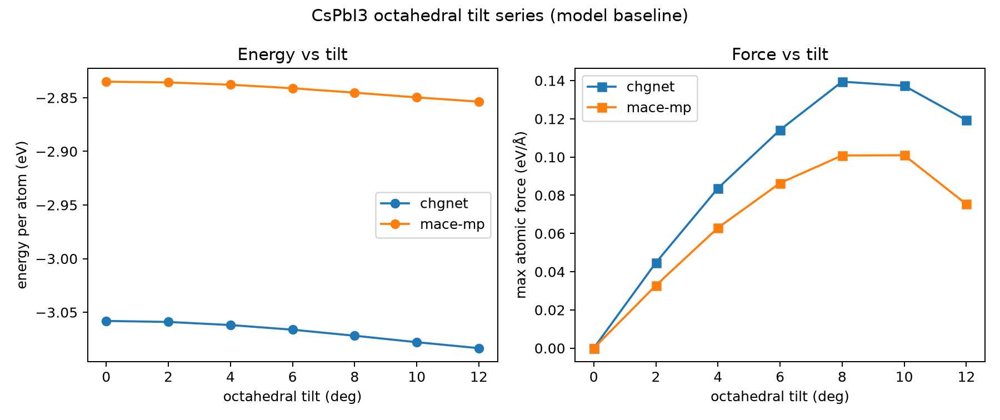
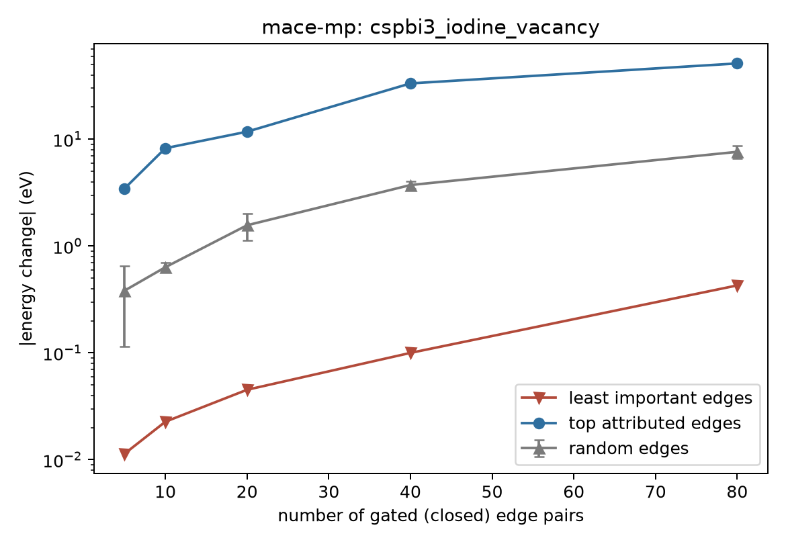
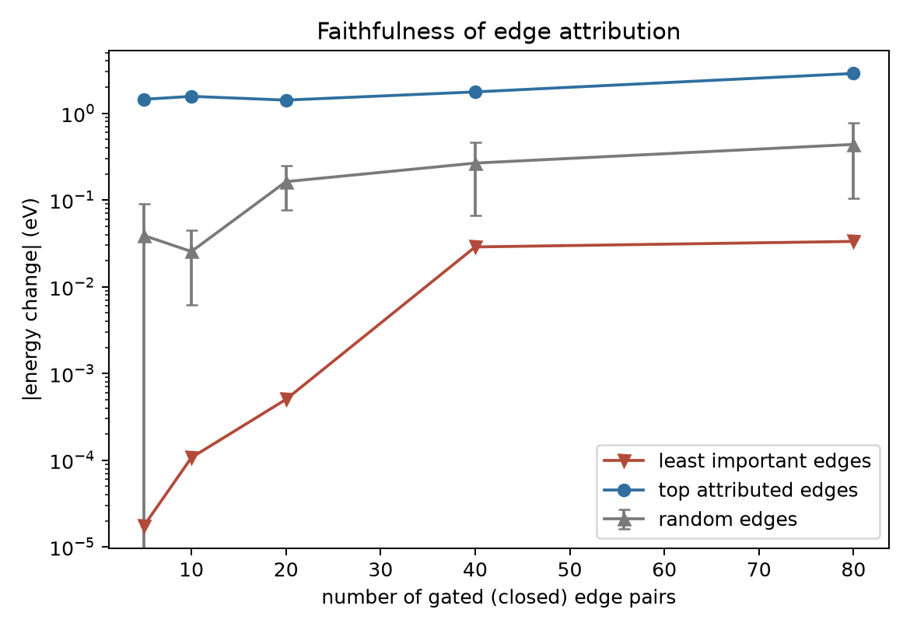

# SRT 项目实验成果与完成情况

整理日期：2026 年 10 月 12 日。本报告依据仓库中已有 JSON、图表和代码整理；本次文档更新没有重新运行 GPU 实验。

## 当前完成到哪里

项目已经完成了力场归因工具和 CsPbI3 案例的主要流程，可以提交阶段成果。第一期建立方法与基础检验，第二期加入跨模型、差分归因和尺寸比较。第三期有探索数据，但还没有完成可用于研究结论的验证。物理参照、通道机制和更广泛的材料实验也仍然缺失，因此现在不能称为全部研究完成。

仓库没有完整的原始 SRT 立项书和验收清单，无法据此给出可靠的完成百分比。以下按实际交付物说明状态。

| 工作 | 状态 | 证据或缺项 |
|---|---|---|
| 结构生成、模型接口、命令行工具 | 已实现 | `src/atomlens/`，基础测试 17 项通过 |
| MACE、CHGNet 的倾斜路径归因 | 已有实验 | 第一期路径与收敛结果 |
| MACE 边门控及消融、旋转、扰动检查 | 已有实验 | 第一期 JSON 与图 |
| CHGNet 边门控与消融 | 已有实验，需完善数值检验 | 第二期；消融和忠实性仍有每原子能量口径问题 |
| 共同边的缺陷差分归因 | 已有实验 | 两模型 2×2×2，另有 MACE 4×4×4 |
| 固定 I2 参考下的形成能与尺寸比较 | 已有实验，物理验证未完成 | 没有弛豫、DFT 参照和相稳定区间 |
| 内部消息与边归因的相关性 | 已有统计结果，解释待复核 | 通道切片尚需验证 |
| 通道门控机制分析 | 探索阶段 | 第三期只有两组数据，存在层间归因和切片核查需求 |
| 哈密顿模型扩展 | 未实现 | 早期笔记提到 HamGNN、DeepH-E3，仓库没有对应实验 |
| 成果文档 | 本次补齐总入口 | 原先只有第一、二期分散报告，第三期没有说明 |

## 实验设置与证据范围

模型使用 MACE-MP small 和 CHGNet，未做微调。环境记录见[manifest.json](../results/case1/manifest.json)。案例为立方 CsPbI3：2×2×2 完美超胞 40 个原子，空位超胞 39 个原子；4×4×4 分别为 320 和 319 个原子。结构由程序生成，空位结构通过删除一个碘原子得到，没有进行结构弛豫。

单个空位占碘位点的比例分别是 1/24 = 4.17% 和 1/192 = 0.52%。旧报告中的 2.6% 和 0.31% 使用的是总原子数口径，不能称作碘位空位浓度。

目前保存了包版本和部分计算参数，但模型权重校验值、统一运行记录和第三期一键脚本尚未齐备。基础测试不加载预训练模型，因此 17 项通过只能说明其覆盖的公式和工具检查通过，不能替代 GPU 实验复现。

## 1. 倾斜路径的能量变化可以由力积分恢复

| 模型 | 40 原子超胞 ΔE / eV | 归因总和 / eV | 残差绝对值 / eV |
|---|---:|---:|---:|
| MACE-MP | −0.588005 | −0.587966 | 0.0000388 |
| CHGNet | −0.793028 | −0.792978 | 0.0000502 |

数据：[MACE](../results/case1/path_ig_mace_tilt.json)、[CHGNet](../results/case1/path_ig_chgnet_tilt.json)。均为 65 个积分采样点。以上是整个超胞的能量变化；除以 8 后，每化学式单位分别约为 −0.0735 和 −0.0991 eV。旧报告把超胞数值写成每原胞数值，需要更正。

两个模型在所选路径上都给出降能趋势。这个结果支持路径积分实现与模型能量差相符，但没有给出真实相变温度或弛豫后相稳定性的证据。坐标路径采用端点之间的线性插值，也应和按角度生成的结构序列区分。

## 2. MACE 边归因与实际门控响应一致

在 39 原子的空位超胞中，MACE 有 290 个原子对。全开与全关的能量差绝对值约为 70.271 eV，32 点积分的完备性残差为 −0.01121 eV，相对约 0.016%。与留一消融排序的 Spearman 为 0.9867。旋转后的最大归因差为 8.88×10⁻¹⁶。

关闭排名前 10 条边时，能量变化约 8.25 eV；随机选择的均值约 0.63 eV。这说明排名在这次模型干预中有区分能力。

数据：[边门控](../results/case1/gating_vacancy.json)、[忠实性](../results/case1/faithfulness_vacancy.json)。

加入标准差 0.03 Å 的随机位移，重复 5 次，边归因的平均 Spearman 为 0.9533，Top-10 Jaccard 为 0.6457。总体排序较稳定，但重要边集合仍会变化，不能说所有稳定性指标都已达到预先规定的标准；仓库并未给出这样的统一验收阈值。

CHGNet 也已完成边门控：24 点积分残差约 −0.1973 eV，相对约 0.234%，与留一消融排序的 Spearman 为 0.9722。残差高于 MACE，但两者的积分点数和精度都不同，尚不能把差异全部归因于 float32。

## 3. 差分归因更适合考察空位附近的变化

总能量边归因主要反映模型整个结构的相互作用。第一期数据中，高排名边并没有更靠近空位，因此总能量归因不适合直接当作缺陷定位结果。

第二期比较空位与完美结构的共同边。MACE 在 2×2×2 和 4×4×4 超胞中都将较大的差分放在空位邻近的 Pb–I 边；CHGNet 也在缺陷邻近边给出较大变化，但具体排名和数值不同。

MACE 差分忠实性实验在 k=10 时，top-k 为 1.5662 eV，随机均值为 0.02546 eV；4×4×4 的 top-k 为 1.5674 eV。数据见[2×2×2](../results/case2/diff_gating_mace_n2.json)和[4×4×4](../results/case2/diff_gating_mace_n4.json)。随机重复仅 5 次，尚未做充分的统计显著性分析。

这里有两个需要保留的限制：

- 输出只列共同边，没有单独列出随碘原子删除而消失的边，因此不是完整缺陷能量的逐边分解。
- CHGNet 的归因输出已换算为总能量，但忠实性函数仍使用每原子能量。完美结构和空位结构的原子数分别是 40、39，不能简单给现有差分曲线乘一个常数修正。现有 [CHGNet 曲线](../results/case2/diff_gating_chgnet_n2.json)不能与 MACE 的总能量曲线直接比较，需统一口径后重跑。

## 4. 固定参考下的空位能量对超胞尺寸变化较小

计算定义为 `E_vacancy − E_perfect + E(I2)/2`。

| 模型 | 2×2×2 / eV | 4×4×4 / eV | 两尺寸差的绝对值 / eV |
|---|---:|---:|---:|
| MACE-MP | 1.05010 | 1.04937 | 0.00073 |
| CHGNet | 1.22358 | 1.20552 | 0.01806 |

来源：[formation.json](../results/case2/formation.json)。

在现有未弛豫结构和模型设置下，这两个尺寸的计算结果接近。它不能证明真实缺陷之间不存在相互作用，也不能代替弛豫后的尺寸收敛检查。有限截断的力场本身也可能使固定结构的缺陷响应表现得较局域。

I2 能量目前只是选定的模型参考，尚未核实分子预测误差和热力学化学势范围。旧报告称其为已经确认的“碘富集极限”过于确定。另外，从当前公式可直接看出，降低 μ_I 会降低形成能；旧文档写成“碘贫条件下形成能更高”，符号关系有误。

## 5. 通道相关性已有结果，机制结论尚未成立

第二期在空位 2×2×2 结构上得到：消息总范数与边归因绝对值的 Spearman 约为 0.592、0.529；标为 layer-1 l2 的指标约为 0.906。其他结构中也有类似的数值趋势，见[相关性数据](../results/case2/correlation_vacancy_n2.json)。

这些是已有程序输出的相关性，暂不应写成“重要性集中在 l2/l3 通道”或“发现了架构机制”。需要先核实以下实现细节：

1. `channels.py` 和 `channel_gating.py` 按 irreps 的 multiplicity 累加切片宽度，没有显式计入 `2l+1`。是否对应当前 conv_tp 输出的实际排列，需要检查模型张量布局；在完成检查前，高阶通道标签下的指标暂不作为确定证据。
2. 第三期所有层共用同一组通道门，CLI 却按层重复输出同一份通道归因占比。这些行不能理解成各层独立的贡献。
3. 第三期全关基线与整条边门控基线不同：空位结构分别约为 −34.553 和 −40.780 eV。现有数据没有支持“通道归因之和已经复现整边归因”的说法。

第三期的两组 JSON 与图保留在仓库中，供后续排查；其状态见[第三期记录](../results/case3/RESULTS.md)。

## 还需要完成什么

近期应先修正 CHGNet 门控能量口径，增加针对性的检查并重跑消融、忠实性实验；再确认 MACE 张量布局，补上分层通道门控、全开复原和整边一致性检查，重跑第二期通道统计及第三期实验。

物理验证需要增加弛豫结构、可靠的 I2 与化学势参照，并与 DFT 数据比较。研究结论还需要更多结构、材料、模型权重与随机重复，以区分一个案例中的规律和可推广的结论。

目前可以汇报的成果是：已建立并运行力场归因流程，在 CsPbI3 上完成路径积分、边门控和共同边差分实验，保存了数据、图表及基础检验。通道机制和真实缺陷热力学仍是后续工作。
